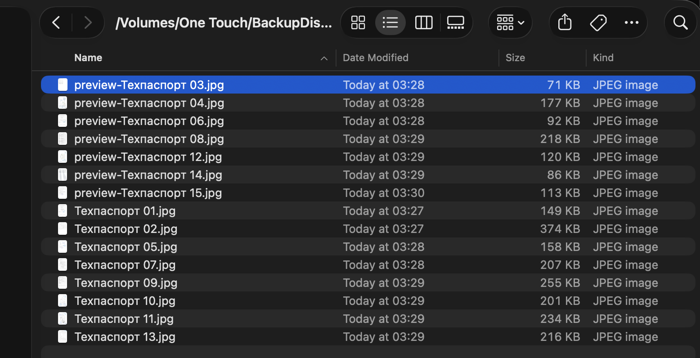
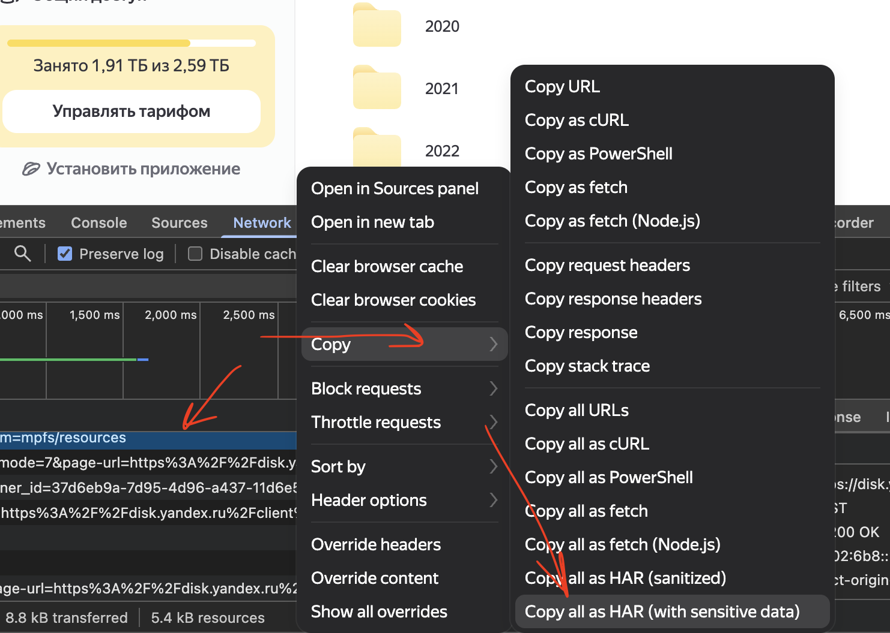

# YDiskSaver

Пример восстановленных файлов: файлы с префиксом `preview-` сохранены из превью, когда оригиналы оказались недоступны.



**YDiskSaver — утилита для восстановления того, что ещё доступно на Яндекс Диске после выхода из строя нескольких дата-центров.** Во время [инцидента в октябре 2026 года](https://www.yandex.com/company/news/2026-10-09) часть возможностей Диска [была ограничена](https://www.rbc.ru/society/11/10/2026/6acbb470b603d0e16d9a1cb0). У некоторых файлов оригинал не скачивается, хотя превью всё ещё отображается в браузере.

**Главная возможность программы:** она сначала пытается скачать исходный файл. Если оригинал недоступен, YDiskSaver пробует сохранить хотя бы его превью в отдельный файл с префиксом `preview-`. Качество такого изображения может быть ниже исходного, но это позволяет восстановить хотя бы часть содержимого, пока превью доступно.

Утилита копирует содержимое **личной папки Яндекс Диска** на локальный диск через API веб-интерфейса. Она полезна, когда обычный API или WebDAV недоступен, а файлы в браузере ещё видны. Публичную ссылку на папку создавать не нужно.

## Возможности

- Рекурсивно копирует вложенные папки и файлы с сохранением структуры.
- Может скачивать несколько файлов одновременно с параметром `--workers`. Обход папок остаётся последовательным; число ожидающих загрузок ограничено.
- Режим `--autoloads` копирует фотографии автозагрузки с меткой `photounlim` из виртуальной папки «Фото» прямо в указанную локальную папку. Обычные файлы Диска и видео в этом режиме не копируются.
- По `SIGHUP` останавливает обход после завершения текущих загрузок и остаётся в памяти; повторный `SIGHUP` продолжает с того же места без повторного обхода уже пройденных папок.
- Если целевой файл уже существует, пропускает его **без запроса ссылки на скачивание**. Размер и дату существующего файла не проверяет.
- Сначала пишет новый файл во временный файл и публикует его под окончательным именем только после успешной загрузки. Работает и с дисками VFAT/FAT32/exFAT, где жёсткие ссылки не поддерживаются. Если известен размер оригинала, проверяет его.
- Если полученный оригинал отличается по размеру от указанного в метаданных, сохраняет полученные байты как `incomplete_<PID>-имя-файла`, не перезаписывая уже существующий файл с таким именем. Если это имя занято другим файлом из списка Диска, программа добавляет номер после PID. Оригинал при этом считается недоступным; программа повторяет попытку и затем пробует сохранить превью.
- При неудаче со скачиванием оригинала пробует несколько размеров превью. Оно сохраняется отдельно с префиксом `preview-`, например `preview-photo.jpg`. Расширение соответствует формату полученного превью. Оригинал при следующем запуске снова будет проверен.
- Продолжает работу после ошибки отдельного файла или папки. По умолчанию таймаут запроса — 8 секунд, оригинала — 30 секунд на попытку, превью — 10 секунд на размер; оригинал пробуется дважды.
- Во время копирования Chrome не запускается. Программа использует ранее сохранённые cookies вашей собственной сессии.

Если при текущем запуске вместо оригинала удалось сохранить только превью, копирование считается неполным: программа покажет ошибку оригинала и завершится с ненулевым кодом. При следующем запуске с `--skip-previews` такой файл будет пропущен без ошибки.

В итоговой статистике `unrecovered` показывает число файлов, для которых не удалось получить ни полный оригинал, ни превью. Счётчик `errors` также включает неудачи оригиналов, для которых превью удалось сохранить, и ошибки обхода папок.

## Установка

Нужен Python **3.9 или новее**. Скачайте или клонируйте этот репозиторий и перейдите в его каталог. Дополнительных Python-пакетов нет:

```bash
cd YDiskSaver
python3 ydisk_saver.py --help
```

## Как получить данные для входа

Программа использует cookies уже авторизованного браузера. OAuth-токен не нужен; параметр `sk` программа получает со страницы Диска при каждом запуске.

1. Войдите в свой Яндекс Диск в Chrome и откройте любую папку своего Диска.
2. Откройте **DevTools → Network** и обновите страницу или перейдите в другую папку. В списке должен появиться запрос к `disk.yandex.ru`, например `models-v2`.
3. В списке запросов выберите **Copy all listed as HAR (with sensitive data)**. Сохраните текст из буфера обмена в UTF-8 файл, например `~/Downloads/ydisk-session.har`.

   

   Если такого пункта нет, то значит включить "Preferences → Network → Allow to generate HAR with sensitive data" в настройках Devtools.
4. Локально преобразуйте HAR в файл сессии:

   ```bash
   python3 har_to_session.py "$HOME/Downloads/ydisk-session.har"
   ```

Конвертер создаст `~/.config/ydisk-saver/session.json` с правами доступа `600`. Он не печатает значения cookies. Сам HAR тоже содержит данные для входа: не публикуйте и не отправляйте его другим людям, не добавляйте в Git. После получения сессии HAR можно удалить. Когда сессия истечёт, повторите эти шаги.

Если у вас уже есть совместимый JSON-файл сессии, передайте его программе через `--state /путь/к/session.json`.

## Использование

В обычном режиме обязательна только **локальная папка назначения**. По умолчанию обход начинается с корня Диска (`https://disk.yandex.ru/client/disk/`), а его содержимое попадает прямо в указанную локальную папку:

```bash
python3 ydisk_saver.py "$HOME/tmp/disk"
```

Чтобы начать с другой папки, укажите `--remote-path`. Он принимает `/disk/...`, `disk:/...` или адрес вида `https://disk.yandex.ru/client/disk/...`. Для имени папки с пробелами или кириллицей заключайте аргумент в кавычки.

```bash
python3 ydisk_saver.py "$HOME/tmp/disk" --remote-path '/disk/Фото/2020'
```

### Автозагрузка фотографий

Для виртуальной папки «Фото» укажите `--autoloads` и локальную папку назначения. Программа сохранит фотографии **прямо в неё**, получит фотосрез через веб-API и запросит ресурсы кластеров с фильтром `photounlim`. Из ответа берутся только изображения из `/photounlim/`; обычные папки, файлы Диска и видео не синхронизируются. `--remote-path` в этом режиме не используется.

```bash
python3 ydisk_saver.py --autoloads "$HOME/tmp/АвтозагрузкаФото" --workers 4
```

Повторный запуск пропускает уже сохранённые файлы. Вложенные пути автозагрузки сохраняются внутри указанной папки. Параметры `--skip-previews`, `--exclude`, таймауты и пауза по `SIGHUP` действуют и в этом режиме. Для `--exclude /путь` отсчёт ведётся от папки назначения. Пустой ответ `photo-get-deltas` не используется как список всех фотографий: он содержит только изменения после снимка. Если фотосрез не вернул ни одного кластера, программа завершится с ошибкой, чтобы пустая выгрузка не считалась успешной.

Настройки ожидания и числа попыток:

```bash
python3 ydisk_saver.py "$HOME/tmp/disk" --remote-path '/disk/Фото/2020' \
  --request-timeout 30 --file-timeout 4 --preview-timeout 4 --retries 2
```

Для больших файлов увеличьте `--file-timeout`. Повторный запуск пропустит уже существующие локальные файлы. Превью не заменяет оригинал: оно остаётся отдельным файлом с префиксом `preview-`.

Для параллельной загрузки добавьте `--workers 4` (допустимо от 1 до 8). По умолчанию используется один поток, как в предыдущих версиях. Начните с 2–4 потоков: при нестабильной работе Диска большее число запросов может увеличить количество ошибок. Программа ставит недостающие файлы текущей папки в очередь, затем продолжает обход вложенных папок. Каждый поток использует собственную HTTP-сессию; сообщения и итоговые счётчики собираются безопасно. Не запускайте одновременно несколько экземпляров программы в одну и ту же локальную папку.

```bash
python3 ydisk_saver.py "$HOME/tmp/disk" --remote-path '/disk/Фото/2020' --workers 4
```

### Пауза для отключения внешнего диска

Пауза работает только в процессе, запущенном с этой версией программы. **Не отправляйте `SIGHUP` старому уже работающему процессу:** он завершится.

Например, запустите копирование в первом терминале (замените пути на свои):

```bash
python3 ydisk_saver.py '/Volumes/Backup/YDisk' --remote-path '/disk/Фото/2020' --workers 4
```

При запуске программа выведет свой PID и готовую команду. Здесь `12345` — только пример; используйте PID из своего вывода:

```text
PID процесса: 12345
Пауза/продолжение: kill -HUP 12345
```

Во втором терминале отправьте показанную команду, чтобы запросить паузу:

```bash
kill -HUP 12345
```

Программа перестанет добавлять новые файлы в очередь и дождётся текущих загрузок. Дождитесь в первом терминале сообщения:

```text
Пауза: загрузки завершены. Можно отключить диск. PID=12345
Для продолжения: kill -HUP 12345
```

**Только после этого сообщения** штатно извлеките внешний диск. Оставьте процесс и терминал работающими; ноутбук можно закрыть. Затем подключите диск снова **по тому же пути** и во втором терминале повторите команду:

```bash
kill -HUP 12345
```

После сообщения `Продолжаю копирование.` программа продолжит обход с того же места.

Если диск ещё не подключён к прежнему пути, программа останется на паузе и попросит повторить сигнал после подключения. В режиме паузы активных загрузок нет, но сам процесс и состояние обхода остаются в памяти. Завершение процесса или перезагрузка ноутбука это состояние теряет; тогда повторный запуск начнёт обход с корня и пропустит уже сохранённые файлы. Если вывод перенаправлен через `>> docs.log 2>&1`, сообщения о паузе и продолжении попадут в тот же файл.

Если ранее удалось сохранить только превью и вы не хотите снова запрашивать недоступный оригинал, добавьте `--skip-previews`. Когда оригинала нет, но рядом уже лежит обычный файл `preview-*`, программа пропустит оригинал без запроса ссылки на скачивание. Такой пропуск входит в счётчик `skipped`; без ключа программа продолжит пробовать скачать оригинал. Если превью ещё нет, поведение остаётся обычным: сначала оригинал, затем попытка получить превью.

```bash
python3 ydisk_saver.py "$HOME/tmp/disk" --remote-path '/disk/Фото/2020' --workers 4 --skip-previews
```

Чтобы пропускать файлы и папки, укажите `--exclude PREFIX` (ключ можно повторять). Шаблон **без начального `/`** сравнивается с началом имени файла или папки на любой глубине. Например, `.git` исключит папки `.git` и `.git-store`, а также файл `.gitignore`, где бы они ни находились. Шаблон **с начальным `/`** сравнивается с началом пути от корня копируемой папки. Например, при копировании `/disk/Фото/2020` шаблон `/10/.git` исключит `/disk/Фото/2020/10/.git`, но не `/disk/Фото/2020/.git`, `/disk/Фото/2020/other/10/.git` или `/disk/Фото/2020/10/05.git`. Сравнение учитывает регистр. Если внутри шаблона есть `/`, шаблон обязательно должен начинаться с `/`: `--exclude '10/.git'` вызовет ошибку при запуске.

Совпавшие папки не создаются локально и не обходятся; совпавшие файлы не ставятся на скачивание. Сама исходная папка не исключается. Итоговые счётчики — `excluded_dirs` и `excluded_files`.

```bash
python3 ydisk_saver.py "$HOME/tmp/disk" --remote-path '/disk/Фото/2020' \
  --workers 4 --exclude '.git' --exclude '/10/cache-'
```

Для диагностики ошибок добавьте `--debug`. Программа покажет обычные сообщения о скачанных и пропущенных файлах вместе с traceback каждой неудачной попытки скачать оригинал или превью и ошибок при обходе папок. Каждая строка журнала начинается с местной даты и времени в формате `ГГГГ-ММ-ДД ЧЧ:ММ:СС`. В режиме `--debug` весь вывод идёт в `stderr` без задержки буферизации:

```bash
python3 ydisk_saver.py "$HOME/tmp/disk" --remote-path '/disk/Фото/2020' --debug
```

В debug-выводе маскируются URL скачивания и поля авторизации. Пути и имена файлов остаются видны.

## Ограничения

Утилита опирается на внутреннее API веб-интерфейса Яндекс Диска. Его формат может измениться. При сбоях сервиса некоторые оригиналы и даже превью могут быть недоступны. Существующий локальный файл считается готовым только по наличию; если он был повреждён до запуска YDiskSaver, программа его не обнаружит.

## Поддержать автора

Если эта утилита помогла вам восстановить важные файлы с Яндекс Диска, вы можете [поддержать меня на Boosty](https://boosty.to/40ants). Спасибо!
